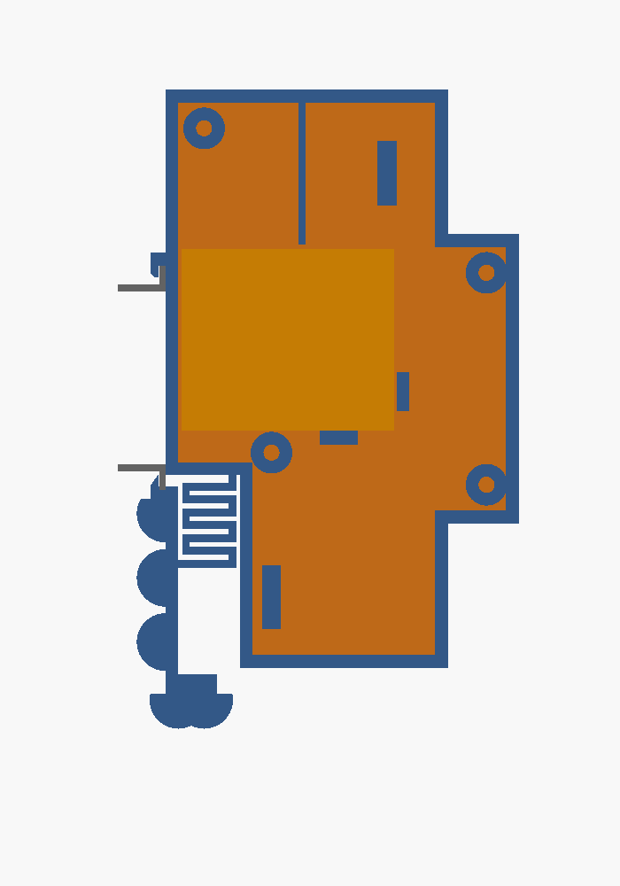

🇬🇧 [English version](gehaeuse.en.md)

# Gehäuse für die Hutschiene (2 TE)

Der Shelly sitzt in einem selbst konstruierten Gehäuse in der Form eines Leitungsschutzschalters: **2 TE breit
(34,6 mm), 90 mm hoch, Frontkragen 45 mm, Schulter 44 mm, Gesamttiefe 55 mm** (DIN 43880 Baugröße 1). Es rastet
wie eine Sicherung auf die Hutschiene TS35 auf. Quelle: [`gehaeuse/tueroeffner-gehaeuse.scad`](../gehaeuse/tueroeffner-gehaeuse.scad),
druckfertig: `tueroeffner_koerper.stl`, `tueroeffner_deckel.stl`.

## Aufbau

*Blick auf die offene Seite (Deckel ab): links die Schiene (grau), rechts der Kragen. Orange ist der Shelly.*

| Teil | Zweck |
|---|---|
| Haken oben (fest) | greift hinter den oberen Flansch |
| Riegel unten mit Mäanderfeder | rastet hinter den unteren Flansch, 0,65 mm Vorspannung. **Lösen:** Schraubendreher von vorn in den Schlitz der Lasche unten stecken und nach unten ziehen (≈ 3 mm) |
| Shelly-Tasche | Rücken an der linken Wand, Typenschild und Klemmschrauben zum Deckel, Klemmleiste oben. Anschlag vorn, Auflage unten, Druckzapfen im Deckel (0,5 mm Luft, ggf. Klebepad) |
| Trennsteg | im Körper über der Klemmleiste **zwischen I und L**, im Deckel neben dem Shelly bis zum Boden → **vorn Netz (L, N), hinten Türöffnerkreis (SW, O, I)** |
| Einführung oben vorn, Ø 6,5 | Netzleitung (Euro-Anschlussleitung 2 × 0,75 mm²), Kabelbinder-Steg darunter |
| Einführung unten hinten, Ø 5,5 | Türöffner-Adern, Kabelbinder-Steg daneben |
| Deckel | rechte Seitenwand, 4 Blechschrauben 2,9 × 13 |

## Vor dem Druck nachmessen ★

| Maß | Annahme im Modell | Parameter |
|---|---|---|
| Shelly 29 × 34 × 16 mm | Shelly-Datenblatt (±0,5), nicht gemessen | `sh_h`, `sh_l`, `sh_t` |
| Lage der Klemmen I und L entlang der Leiste | Teilung 34/5 → Steg 22,9 mm hinter der Rückwand | `steg_y` |
| Tiefe Schiene → Abdeckung am eigenen LS-Schalter | 44 mm (Norm: ≤ 44) | `T_sch` |
| Kragen passt durch den Abdeckungsausschnitt | 45 mm (Ausschnitt meist 46) | `H_krag` |

## Prüfungen (OpenSCAD)

`openscad -D 'TEIL="pruef_shelly"' …` usw. Jede Prüfung ist eine Schnittmenge und muss **leer bzw. 0 mm³** sein.

| Prüfung | Ergebnis 21.10.2026 | Alarmpfad belegt mit |
|---|---|---|
| `pruef_shelly` – Shelly gegen Körper + Deckel | 0 mm³ (nur Auflagefläche) | Shelly 3 mm tiefer → 212,7 mm³ |
| `pruef_riegel` – Riegel 3 mm gezogen gegen Körper | leer | Riegel 3 mm hoch → 90,0 mm³ |
| `pruef_schiene` – eingerastete Schiene gegen Gehäuse | 0 mm³ (nur Anlage) | Nase 0,65 mm zu dick → 56,4 mm³ |

## Druck

**Fertig voreingestellt für Bambu Lab P1S:** [`gehaeuse/tueroeffner-gehaeuse-p1s.3mf`](../gehaeuse/tueroeffner-gehaeuse-p1s.3mf) – Körper und Deckel auf einer Platte, P1S 0,4 mm, Bambu PETG Basic (255 °C / Platte 70 °C), Textured PEI Plate, 0,20 mm, 3 Wände, 4 Decken-/Bodenlagen, 25 % Füllung, Arachne, ohne Stützen, ohne Brim. Gesliced: **1 h 57 min, 52,3 g**. Nach dem Ändern von Maßen die STL neu exportieren und die 3MF neu erzeugen.

- **PETG**, 0,2 mm, 3 Wände, ohne Stützen. PLA ist ungeeignet, weil die Feder Zähigkeit braucht und es im Verteiler warm wird.
- Den Körper auf der **linken Seite** drucken (`TEIL="koerper"` dreht ihn so). Dann liegen Feder und Haken in der
  Druckebene und biegen nicht gegen die Schichthaftung. Den Deckel mit der Außenseite nach unten drucken.
- Nach dem Druck den Riegel einmal von Hand durchziehen, damit sich die Spalte (0,6 mm) lösen.

## Brandschutz – ehrlich eingeordnet

Gedrucktes PETG ist **nicht flammhemmend**. Gekaufte Hutschienengehäuse sind aus Polycarbonat UL94 V-0. Der
Shelly hat selbst ein geschlossenes Gehäuse, das gedruckte Teil ist eine zusätzliche Hülle. Wer es normgerecht
will, druckt in einem V-0-Filament (PC-FR, PETG-V0) oder nimmt ein Leergehäuse:

| Gehäuse | Maße | Material | Preis (reichelt, 21.10.2026) |
|---|---|---|---|
| CamdenBoss CNMB/2/KIT („CB HUTKIT 2“) | 36 × 90 × 58 mm, Boden 86,5 × 33 | PC, UL94 V-0 (grauer Deckel) | 8,15 € |
| apra-norm apraRail DB 2 | 36 × 90 × 58 mm | PC, UL94 V-0 | 7,30 € |

Beide sind 58 mm tief (Baugröße 2), passen in übliche Kleinverteiler, haben aber keinen Trennsteg und keine Zugentlastung.
